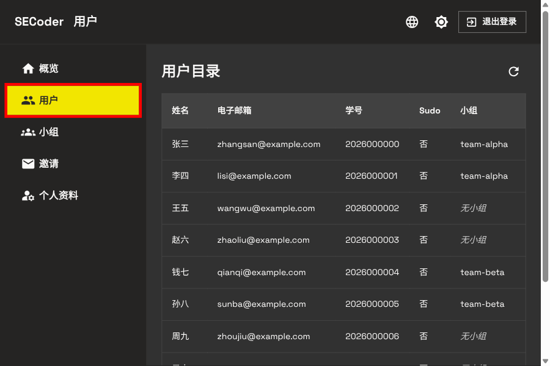
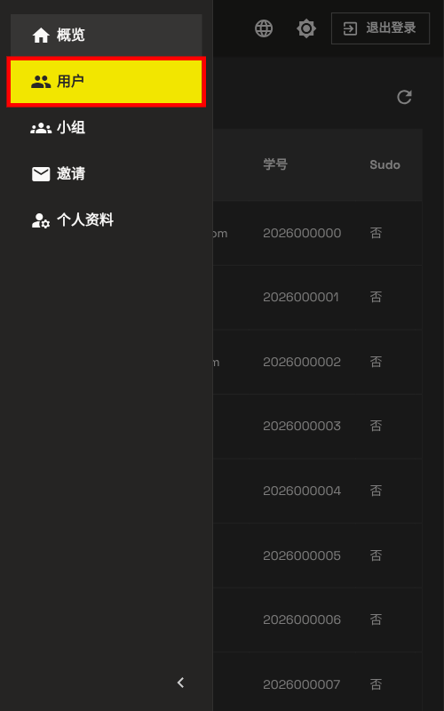

# 用户目录

登录后, 通过侧边栏点击 **用户** 可以打开只读的用户目录. 该页面用于查看当前平台
已经注册的用户及其组队状态, 不提供修改用户资料或管理账号的操作.

  
  

目录按学号排序, 显示以下字段:

- **姓名**
- **电子邮箱**
- **学号**
- **sudo**: 是否为平台管理员账号
- **小组**: 当前加入的小组标识符; 尚未组队时显示 **无小组**

当前界面显示首批最多 10 条记录. 点击页面右上角的刷新按钮可以重新读取列表.
如果姓名、邮箱或组队信息刚刚发生变化但尚未显示, 先刷新目录; 仍不一致时再联系课程管理员.
